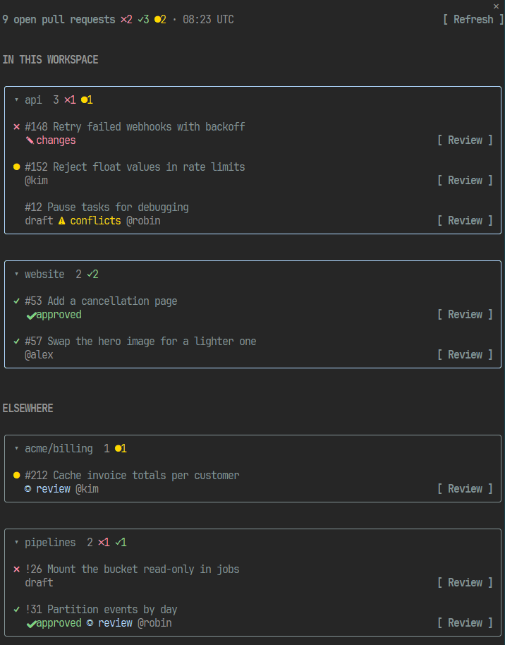
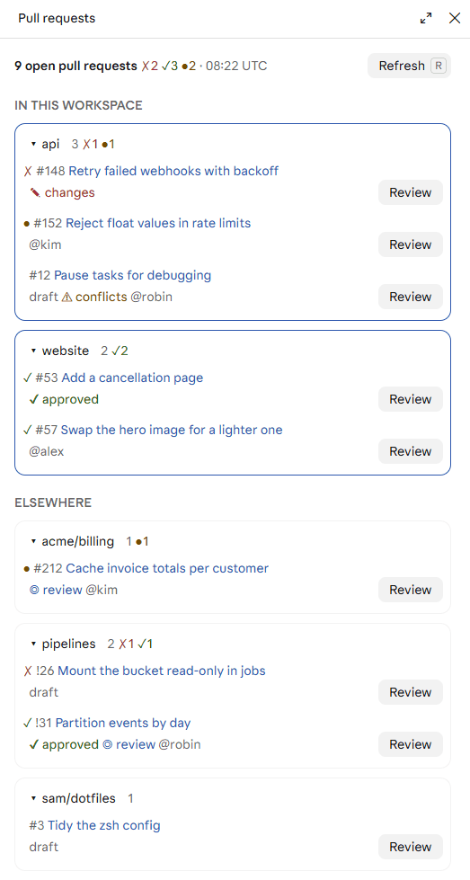

# pull-requests

Open pull requests from GitHub and GitLab in a pane beside the chat, each with its checks, review and draft state at a glance, and a button to have Claude review it.



## Overview

The pane opens when the session starts. It lists the open pull requests (and GitLab merge requests) for the repos you're working in, grouped by repo, then yours from anywhere else.

Each repo is a card: click its name to fold it away (`▸`) or open it again (`▾`), and its header counts its PRs and tallies their checks. A GitLab project nested in groups goes by its own name. Each title is a link to the pull request, and **Review** under it asks Claude to review it.

- **Your repos** are the git repo the session starts in, or every repo below it in a folder of repos, four levels deep at most. A pull request belongs to a repo when its target or its source matches any of the repo's remotes, so your PRs from a fork land under the repo you cloned. Each repo shows its five most recently updated.
- **Elsewhere** are the open pull requests you wrote or are asked to review, anywhere else on GitHub or the GitLab hosts you use, grouped by repo.

In Claude Code Desktop the pane sits beside the conversation:

<picture>
  <source media="(prefers-color-scheme: dark)" srcset="docs/images/desktop-dark.png">
  
</picture>

| Marker | Meaning |
| --- | --- |
| `✓` `✗` `●` `○` | Checks or pipeline passing, failing, running, or something else (cancelled, skipped, manual). Blank when there are none |
| `draft` | A draft |
| `✔ approved` `✎ changes` | Approved, or changes requested (GitHub only: GitLab reports approval alone) |
| `⚠ conflicts` | Conflicts with its target branch |
| `◎ review` | Your review is requested |
| `@name` | Its author, when it isn't you |

## Commands

`/prs` opens the pane, refreshes it and says how many it found. The titles stay in the pane, out of Claude's context, since most are other people's words. In the pane, **Refresh** (`r`) asks again, and each pull request's **Review** asks Claude to review it, by its link alone.

## Settings

| Setting | Default | What it does |
| --- | --- | --- |
| `gitlabHosts` | `gitlab.com` | GitLab hosts to ask, comma-separated: your merge requests there, and those of any session repo whose remote is on one. Only these are asked, never a host a remote names on its own. Blank it if you don't use GitLab |
| `refreshMinutes` | `5` | How often the pane asks again, once a minute at most |

GitHub Enterprise isn't covered yet: only `github.com`.

## Installation

At the prompt of a Claude Code session:

```
/plugin install pull-requests --marketplace farridav/claude-code-pull-requests
```

Answer `y` to add the marketplace, then pick a scope. From a shell:

```
claude plugin install pull-requests --marketplace farridav/claude-code-pull-requests
```

In the desktop app, where `/plugin` does not run: click + next to the prompt box, then Plugins, Add marketplace with `farridav/claude-code-pull-requests`, then Add plugin.

## Requirements

- A Claude Code build where function hooks (mods) are enabled. This API is early access and may change between releases.
- `git` on the `PATH`, to read each repo's remotes.
- The command-line tool for each service you use, on the `PATH`; either is optional. The pane reads everything through them, with the logins you already have, and needs no token of its own.
  - **GitHub:** [GitHub CLI](https://cli.github.com) (`gh`)
  - **GitLab:** [GitLab CLI](https://gitlab.com/gitlab-org/cli#installation) (`glab`), for gitlab.com or your own hosts
- macOS or Linux. Windows paths are untested.

## Logging in

In a terminal, for the browser flow:

```bash
gh auth login
```

```bash
glab auth login --hostname gitlab.com
```

Or skip that: a service you're not logged in to shows in the pane with a **Log in** button. It links to the token page with the scopes `gh` or `glab` asks for filled in, and logs the CLI in with the token you paste. The token goes to the CLI on stdin, never to Claude.

`gh` and `glab` run with the `env` from your Claude Code settings, so a `GH_TOKEN`, `GITLAB_TOKEN` or proxy set there is used too.

## Troubleshooting

**A service shows Log in though you're logged in.** Its token has expired or lacks a scope: `gh auth status` or `glab auth status --hostname <host>` says which. Log in again, from a terminal or the pane.

**A GitLab host is missing.** Only the hosts in `gitlabHosts` are asked. Add yours there.

**A repo of yours has no card.** A repo shows only when it has open pull requests, and only when one of its remotes is on github.com or a host in `gitlabHosts`. Start Claude Code in the repo, or in the folder that holds it, at most four levels up.

**The list looks stale.** It refreshes every `refreshMinutes`. Press **Refresh** (`r`) or run `/prs` to ask now.

## What it hooks

| Event | What the hook does |
| --- | --- |
| `session.start` | Registers `/prs`, opens the pane, refreshes, and starts the refresh timer |
| `command.run` of `prs` | Opens the pane, refreshes, and answers with a count, never the titles |
| `ui.render` of the `pull-requests` `Pane` | Draws the cards, with Refresh, Review, Log in and the token box |

## What it calls on `$`

`clock.every`, `clock.now`, `command.register`, `fs.list`, `fs.read`, `process.run` (git, gh, glab), `prompt.submit` (Review), `session.root`, `settings.read` (the `env` key), `state.get`, `state.set`, `ui.open`, `ui.resolve`, `ui.toast`.

## Commands it runs

| Command | When |
| --- | --- |
| `git -C <repo> remote -v` | Each refresh, in each repo found |
| `gh api graphql` | Each refresh: one request covering your PRs, your review requests and each repo's latest |
| `glab api graphql --hostname <host>` | Each refresh, one request per GitLab host |
| `gh auth login --with-token`, `glab auth login --hostname <host> --stdin` | When you paste a token after Log in |

A refresh happens at session start, on Refresh or `/prs`, and on the timer. Those and a login are the only network calls, and the queries only read.

## Developing

Run it from a checkout:

```bash
claude --plugin-dir /path/to/claude-code-pull-requests
```

| Command | What it does |
| --- | --- |
| `make deps` | Installs the Claude Code CLI version the checks run on (pinned in the Makefile) |
| `make check` | `claude plugin validate .`: the manifest, the marketplace and the hooks module |
| `make test` | `claude plugin test .`: the tests in `tests/`, run against the engine |
| `make typecheck` | `tsc -p .`, once Claude Code has written its API types into `.claude-plugin/types/`, which it does when it loads the mod |
| `make package` | Zips the mod as `dist/pull-requests-v<version>.plugin` |

CI (`.github/workflows/build.yml`) runs `deps`, `check`, `test` and `package` on every push and pull request to `main`. `typecheck` stays local: the API types come from a Claude Code session, and CI has none.

- `hooks/register.tsx` is the hooks module: the pane, `/prs` and the refresh timer.
- `hooks/prs.ts` finds the repos and their remotes, builds and parses the GraphQL queries, and groups the results.
- `types/index.d.ts` is the contract for the values kept in `$.state`.
- Tests are in `tests/`, one file for what each module covers.

## Releasing

1. Merge pull requests as usual, labelled so they land under the right heading (`feature`/`enhancement`, `fix`/`bugfix`/`bug`, `chore`/`dependencies`/`documentation`). [Release Drafter](https://github.com/release-drafter/release-drafter) keeps a draft of the next release up to date. Until the version is bumped, the draft's title says it isn't ready.
2. When you're ready, bump the version in a pull request with `make version VERSION=x.y.z` and merge it. The draft becomes `vx.y.z`, and CI attaches `pull-requests-vx.y.z.plugin` to it.
3. Publish the draft.

Installs update when the version in `plugin.json` changes, so merging the bump is when people get it; publish soon after. Releases are immutable once published, which is why CI attaches the package to the draft beforehand. `make version` refuses a version that's already released. The version changes only through pull requests, so CI never pushes to `main`.

## Contributing

Issues and pull requests are welcome: see [CONTRIBUTING.md](CONTRIBUTING.md). Report security problems privately, as [SECURITY.md](SECURITY.md) describes.

## Author

farridav. Released under the [MIT License](LICENSE).
