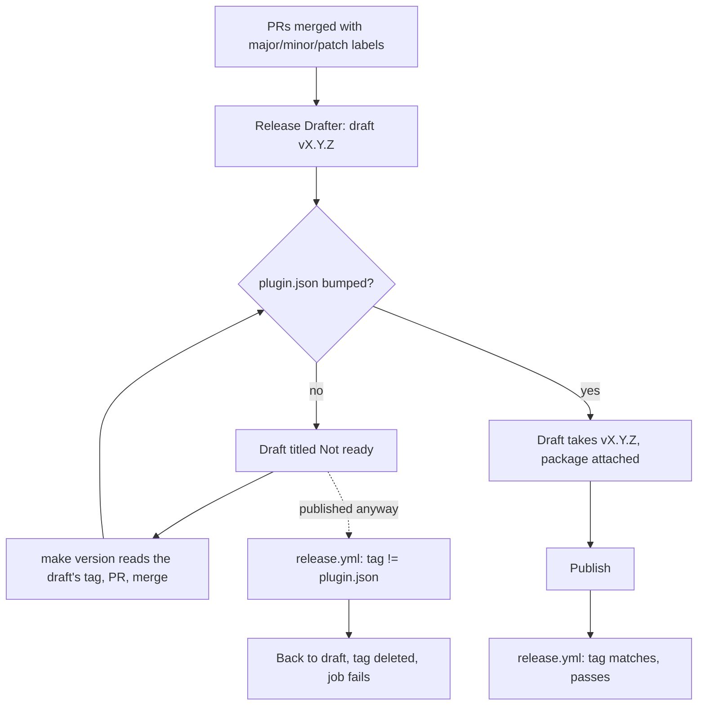

# Release guard and `make version` default

v0.1.1 was published from a draft still titled "Not ready", so its tag carried `plugin.json` at 0.1.0. This bumps `plugin.json` to 0.1.1, adds a workflow that pulls a release back to a draft if its tag doesn't match `plugin.json`, and makes `make version` take the draft's version by default.

| File | Change | Reason |
| --- | --- | --- |
| `.claude-plugin/plugin.json` | 0.1.0 → 0.1.1 | The version v0.1.1 should have shipped with |
| `.github/workflows/release.yml` | New: checks the published tag against `plugin.json` | CONTRIBUTING described this check, but it didn't exist, so nothing stopped a not-ready draft going out |
| `Makefile` | `make version` defaults to the draft release's version | Saves reading the draft and typing the number, so the bump matches what the labels resolved |
| `CONTRIBUTING.md` | Releasing steps rewritten | They now match what the workflows actually do |

Not acted on: `jq -r .version .claude-plugin/plugin.json` now appears in `build.yml`, `release.yml` and the Makefile's `package` target. A `make plugin-version` target could serve all three if the path ever changes.
