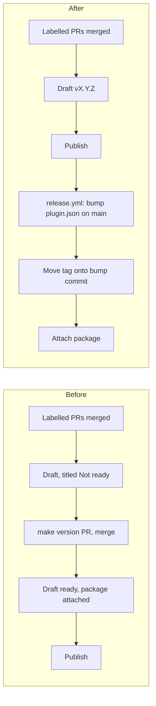

# Publish a release, and that's the release

v0.1.1 was published before `plugin.json` was bumped, because the bump was a separate pull request that was easy to forget. Now publishing the draft is the only step: a workflow bumps `plugin.json` on `main` to match the tag, moves the tag onto that commit and attaches the package.

| File | Change | Reason |
| --- | --- | --- |
| `.claude-plugin/plugin.json` | 0.1.0 → 0.1.1 | The version v0.1.1 should have shipped with. The workflow leaves `plugin.json` alone when it already matches |
| `.github/workflows/release.yml` | New: on publish, bumps `plugin.json` on `main`, moves the tag, attaches the package | Makes publishing the only step |
| `.github/workflows/build.yml` | Draft job is now just Release Drafter | No not-ready title and no package on the draft, since the release workflow handles both |
| `Makefile` | `version` target and `VERSION` removed | Nobody bumps by hand any more |
| `README.md`, `CONTRIBUTING.md` | Releasing steps rewritten | They now describe the two steps that remain |

Repo settings this relies on: a write deploy key ("Release workflow") whose private half is the `RELEASE_DEPLOY_KEY` secret in the `release` environment (only `v*` tags can use it), deploy keys on the `main` ruleset's bypass list, and immutable releases off. GitHub Actions can't be a bypass actor on a personal-account repo, which is why it's a deploy key.

Not acted on: `jq -r .version .claude-plugin/plugin.json` appears only in the Makefile's `package` target now, so there's nothing to extract.
